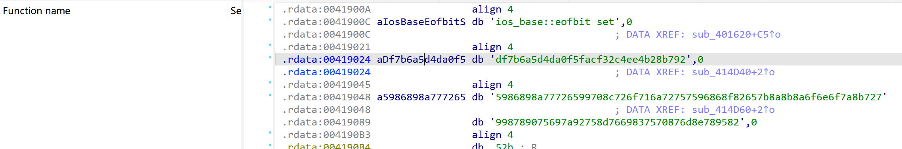
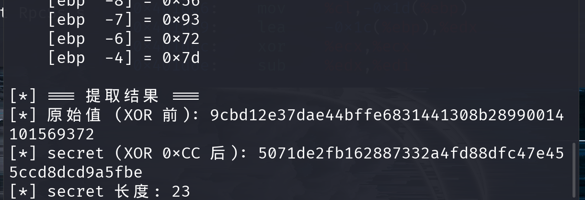
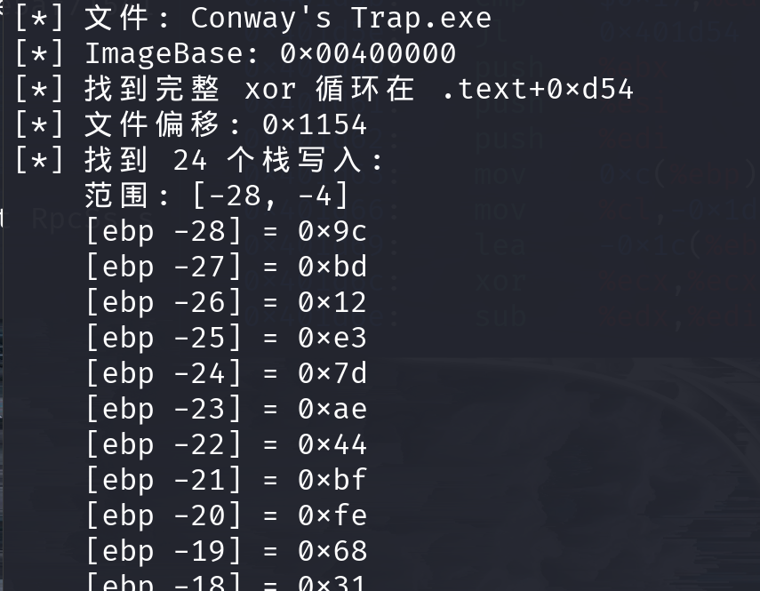

# Conway's trap

> 比赛：ISCC 2026　方向：Reverse　作者：封釉、杨心凌
>
> 原稿中的邮箱、Flag 和公网地址已省略。题目二进制附件未随本次文件夹提供。

## 题目信息

- **题目描述：** 程序要求输入 16 字节 seed，经多轮变换后与运行时解密的 secret 比较，并由相关数据构造动态 Flag。
- **附件与环境：** 原稿提到 `attachment-63.zip` 和 `caterpillar38.exe`，但本次收到的文件夹中没有这些附件。
- **关键线索：** `.data` 中保存着运行时堆指针；secret 在栈上经 XOR 循环解密。

## 解题思路

静态分析发现，输入的 16 字节 seed 会经过 5 轮按字节运算和整体循环移位。程序还使用一个 seed target 与 23 字节 secret 构造校验结果。

原稿通过动态调试发现 `.data` 固定偏移处保存的是堆指针，而不是 seed target 本身；secret 则在栈帧上经过 XOR 解密。因此转向运行时分析，读取 seed target 与解密后的 secret，再根据汇编推导逆变换。



## 分析与复现

单轮正向变换按两字节一组计算：

```text
u = (x + y) & 0xff
v = ROL(y ^ u, 1)
```

之后整体循环左移 1 字节。逆向时先整体循环右移，再按组计算：

```text
y = ROR(v, 1) ^ u
x = (u - y) & 0xff
```

对 seed target 连续执行 5 轮逆变换，得到原始 seed。随后按原稿给出的关系从 secret 重建 flag body：

```text
t = ROR(secret[i] ^ 0xaa, 3)
t = (t - ((i * 0x17) & 0xff)) & 0xff
flag[i] = t ^ seed[i & 0x0f]
```

调试记录截图中的 secret 数据已保留作为题解证据；Flag 输出已脱敏。





## 核心代码

```python
#!/usr/bin/env python3
# -*- coding: utf-8 -*-
"""
基于内存提取常量恢复 Flag
"""
def byte_rol(val, n):
    """8-bit rotate left"""
    return ((val << n) | (val >> (8 - n))) & 0xFF
def byte_ror(val, n):
    """8-bit rotate right"""
    return ((val >> n) | (val << (8 - n))) & 0xFF
def invert_single_round(state):
    """
    逆向单轮混淆。
    正向流程：按2字节更新后整体左旋1字节。
    逆向时先右旋，再反推原始2字节对。
    """
    buf = bytearray(state)
    # Step 1: 循环右移1字节
    buf = buf[-1:] + buf[:-1]
    # Step 2: 2字节分组逆运算
    for offset in range(0, 16, 2):
        u, v = buf[offset], buf[offset + 1]
        y = byte_ror(v, 1) ^ u
        x = (u - y) & 0xFF
        buf[offset], buf[offset + 1] = x, y
    return bytes(buf)
def retrieve_original_seed(target_hex):
    """对32字符hex执行5轮逆向，还原16字节seed"""
    current = bytearray.fromhex(target_hex)
    for _ in range(5):
        current = invert_single_round(current)
    return bytes(current)
def rebuild_flag_content(seed, secret):
    """
    依据 secret 与 seed 重建 flag body。
    汇编级推导：
        tmp = ROR(secret[i] ^ 0xAA, 3)
        tmp = (tmp - (i * 0x17 & 0xFF)) & 0xFF
        out[i] = tmp ^ seed[i & 0x0F]
    """
    payload = bytearray()
    for index, s_val in enumerate(secret):
        acc = byte_ror(s_val ^ 0xAA, 3)
        acc = (acc - ((index * 0x17) & 0xFF)) & 0xFF
        payload.append(acc ^ seed[index & 0x0F])
    return bytes(payload)
if __name__ == "__main__":
    # 以下常量通过 gdb 动态调试从进程内存中提取
    MEMORY_SEED_TARGET = "df7b6a5d4da0f5facf32c4ee4b28b792"
    MEMORY_SECRET_RAW = "5071de2fb162887332a4fd88dfc47e455ccd8dcd9a5fbe"
    secret_bytes = bytes.fromhex(MEMORY_SECRET_RAW)
    original_seed = retrieve_original_seed(MEMORY_SEED_TARGET)
    flag_body = rebuild_flag_content(original_seed, secret_bytes)
    print(f"[+] 原始 Seed: {original_seed.hex()}")
    print(f"[+] Flag Body (hex): {flag_body.hex()}")
    print("[+] Flag Body (ascii): [REDACTED]")
    print("[+] Final Flag: [REDACTED]")
```

## 结果验证

在获得原始题目附件后，可运行脚本验证逆向 seed 与重建结果。原稿中的 Flag 内容不在本文展示。

## 复盘与经验

- **关键知识点：** 字节级 ARX 变换、循环移位、XOR 解密、静态分析与动态调试结合。
- **容易踩的坑：** 运行时指针不能当作静态字符串地址；编译优化可能导致静态模拟栈初始化结果不可靠。
- **材料限制：** 题目 exe/zip 未随本次投稿提供。脚本中的常量来自 Word 原稿记录，完整复现仍需要赛事原始附件。

## 参考资料

- 原稿记录的 GDB 与 IDA 调试步骤；题目附件待补充。
