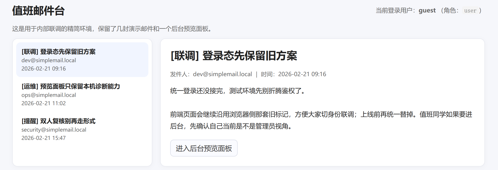
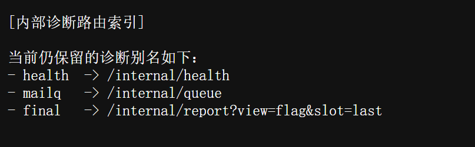
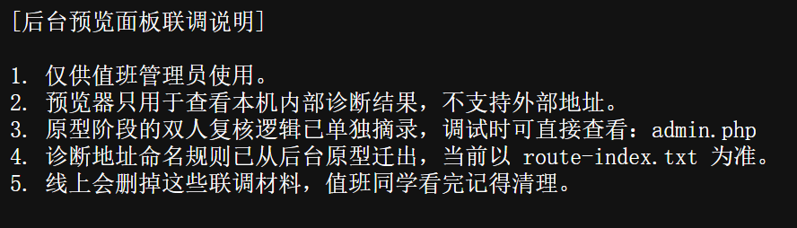

# 值班邮件台

> 比赛：ISCC 2026　方向：Web　作者：封釉、杨心凌
>
> 仅在赛事授权的题目环境中复现。原稿中的邮箱、靶场地址、会话信息和 Flag 已省略。

## 题目信息

- **题目描述：** 检查值班邮件台的访问控制、邮件预览和内部诊断功能。
- **附件与环境：** 原稿没有提供独立二进制或脚本附件；关键线索来自页面和邮件内容。
- **关键线索：** 后台预览页、`route-index.txt` 中的内部路由，以及双人复核流程。

## 解题思路

先观察邮件台的页面权限。原稿记录了一个仅面向管理员的后台预览入口，并提示需要关注浏览器会话与角色判断。进入预览页面后，邮件内容提示查看 `route-index.txt`。

路由索引列出 `health`、`mailq` 和 `final` 三个内部别名，其中 `final` 指向报告接口。另一封联调说明提到双人复核和预览凭据。原稿尝试了 PHP 弱比较中常见的两个测试值 `240610708` 和 `QNKCDZO`，随后将诊断请求指向题目环境的本机回环地址，最终在报告结果中获得题目反馈。

## 分析与复现

先从 `route-index.txt` 获取题目实际开放的路由，不要猜测或扫描比赛基础设施。原稿中的有效路由关系如下：

联调说明还强调，后台预览能力仅供授权角色使用，且内部诊断只应接受本机地址：

原稿没有保留完整 HTTP 请求或 PoC，因此本文只整理可确认的验证顺序：检查角色控制、读取路由索引、分析双人复核比较逻辑，再在题目环境中验证内部诊断路由。不要把内部诊断地址改为任意外部地址。

## 核心代码

原稿未提供独立脚本或完整请求样例。

## 结果验证

以授权测试账户访问后台预览页，并在允许的本地诊断流程中确认返回结果。原稿中的 Flag 和会话值已脱敏。

## 复盘与经验

- **关键知识点：** 角色访问控制、会话校验、PHP 弱比较、内部路由与 SSRF 风险。
- **容易踩的坑：** 不能仅依赖前端隐藏菜单；内部诊断功能若接受用户可控地址，可能变成 SSRF。
- **后续改进：** 后端逐请求检查角色权限；复核凭据使用强随机值和恒定时间比较；内部诊断采用固定路由映射并限制回环访问目标。

## 参考资料

- [OWASP Server-Side Request Forgery Prevention Cheat Sheet](https://cheatsheetseries.owasp.org/cheatsheets/Server_Side_Request_Forgery_Prevention_Cheat_Sheet.html)
