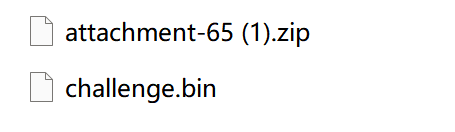

# 数字奥秘

> 比赛：ISCC 2026　方向：Misc　作者：杨心凌
>
> 仅在赛事授权的题目环境中复现。原稿中的邮箱、靶场地址和 Flag 已省略。

## 题目信息

- **题目描述：** 综合文件分析与基础密码学题。目标是从附件中提取隐藏数据，恢复传感器数值并解开加密内容。
- **附件与环境：** [题目压缩包](assets/number-mystery-attachment.zip)、[challenge.bin](assets/challenge.bin)。`challenge.bin` 实际为 PNG 文件。
- **关键线索：** PNG 文本块包含 `SYNC_CODE`、`PERIODS` 和 `SYNC_PAYLOAD`；压缩包中还包含 `challenge.bin` 的副本。



## 解题思路

先根据文件签名确认 `challenge.bin` 是 PNG，而不是普通二进制数据。随后读取 PNG 的文本块，取得 Brainfuck 程序、周期列表和加密载荷。

原稿给出的解法从 Brainfuck 代码中统计 `*#` 前的连续 `+` 数量，并按 `round(n * 0.1)` 还原传感器数据。将这些数据作为同余方程的余数，与 `PERIODS` 一起使用中国剩余定理合并。该实现允许模数不互素，并在不相容时抛出异常。

密钥后缀通过多层 Base64 解码得到。把 CRT 结果与后缀拼接后计算 SHA-256，再将摘要循环作为 XOR 密钥解密载荷。

## 分析与复现

将压缩包下载到本地后，可把下方脚本保存为 `solve.py`，并传入附件路径：

```text
python solve.py assets/number-mystery-attachment.zip
```

脚本依赖标准库。它会解析 PNG 文本块、计算 CRT 结果并解密载荷；Flag 输出按赛事公开规则脱敏。

## 核心代码

```python
#!/usr/bin/env python3
# -*- coding: utf-8 -*-
"""Solve 数字奥秘 - 兼容 attachment-65.zip 结构"""
import zipfile
import re
import base64
import hashlib
import ast
from math import gcd
from pathlib import Path
HINT_B64 = "VTFWT1Fsb3diRVJSVjJSS1VraENWVll4VlRGU1JtZDRWR3RhVldKRk5WRldWM2MwWlZVeFJWTlVSVDA9"
def nested_b64_decode(s: str) -> str:
    cur = s.strip()
    last = cur
    for _ in range(20):
        try:
            raw = base64.b64decode(cur, validate=True)
            text = raw.decode("utf-8")
            last = text
            cur = text.strip()
        except Exception:
            break
    return last
hint = nested_b64_decode(HINT_B64).strip()
print(f"[+] Decoded hint: {hint!r}")
def crt_pair(a, m, b, n):
    g = gcd(m, n)
    if (b - a) % g != 0:
        raise ValueError("inconsistent")
    m1, n1 = m // g, n // g
    t = ((b - a) // g * pow(m1, -1, n1)) % n1
    return (a + m * t) % (m * n1), m * n1
def crt(residues, moduli):
    x, mod = residues[0] % moduli[0], moduli[0]
    for r, m in zip(residues[1:], moduli[1:]):
        x, mod = crt_pair(x, mod, r % m, m)
    return x, mod
def solve(zip_path: Path):
    with zipfile.ZipFile(zip_path, 'r') as zf:
        names = zf.namelist()
        print(f"[+] ZIP contents: {names}")
        challenge = zf.read('challenge.bin')
        print(f"[+] challenge.bin size: {len(challenge)} bytes")
        # 手动解析 PNG 文本块
        text_chunks = {}
        pos = 8
        while pos < len(challenge):
            if pos + 8 > len(challenge):
                break
            length = int.from_bytes(challenge[pos:pos+4], 'big')
            ctype = challenge[pos+4:pos+8].decode('ascii', errors='ignore')
            chunk_data = challenge[pos+8:pos+8+length]
            if ctype in ('tEXt', 'iTXt', 'zTXt') and b'\x00' in chunk_data:
                k, v = chunk_data.split(b'\x00', 1)
                text_chunks[k.decode()] = v.decode('utf-8', errors='ignore')
            if ctype == 'IEND':
                break
            pos += 12 + length
        print(f"[+] PNG text chunks keys: {list(text_chunks.keys())}")
        # 提取 brainfuck 代码（在 SYNC_CODE 里）
        bf_code = text_chunks.get('SYNC_CODE', '')
        if not bf_code:
            raise ValueError("SYNC_CODE not found in PNG tEXt!")
        print(f"[+] BF code length: {len(bf_code)}")
        # 统计 + 数量
        plus_counts = [len(m.group(1)) for m in re.finditer(r"(\+*)\*#", bf_code)]
        print(f"[+] Plus counts: {plus_counts}")
        correct_sensor = [round(n * 0.1) for n in plus_counts]
        print(f"[+] Correct sensor data: {correct_sensor}")
        # 提取 PERIODS
        periods = ast.literal_eval(text_chunks['PERIODS'])
        print(f"[+] PERIODS: {periods}")
        # 提取 PAYLOAD
        payload = text_chunks['SYNC_PAYLOAD'].strip()
        print(f"[+] PAYLOAD: {payload}")
        # CRT
        merged_result, modulus = crt(correct_sensor, periods)
        print(f"[+] CRT result: {merged_result}, modulus: {modulus}")
        # 生成 key
        key_str = f"{merged_result}{hint}"
        xor_key = hashlib.sha256(key_str.encode()).digest()
        print(f"[+] SHA256 key (hex): {xor_key.hex()}")
        # 解密
        ciphertext = base64.b64decode(payload)
        plaintext = bytes(c ^ xor_key[i % len(xor_key)] for i, c in enumerate(ciphertext))
        flag = plaintext.decode('utf-8', errors='ignore')
        print("\n[+] FLAG: [REDACTED]")
        return flag
if __name__ == "__main__":
    import argparse
    parser = argparse.ArgumentParser()
    parser.add_argument("zip", nargs="?", default="attachment-65.zip")
    args = parser.parse_args()
    solve(Path(args.zip))
```

## 结果验证

检查 PNG 文本块是否成功解析、CRT 合并是否通过一致性校验，以及解密结果是否符合题目格式。Flag 内容已按公开规则脱敏。

## 复盘与经验

- **关键知识点：** 文件签名识别、PNG 文本块、Brainfuck 数据提取、非互素模数下的 CRT、Base64 和 XOR。
- **容易踩的坑：** 文件扩展名不代表真实格式；CRT 的模数不互素时不能直接套用互素版本。
- **材料限制：** 原稿提到 `sensor_data.bf`、`vm.py` 和 `info.txt`，但本次收到的压缩包只含 `challenge.bin`。原稿没有记录虚拟机具体修复内容或完整的中间计算值，因此该部分无法仅凭当前附件独立复现。

## 参考资料

- [随稿提供的题目压缩包](assets/number-mystery-attachment.zip)
